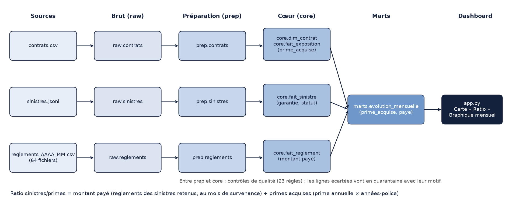
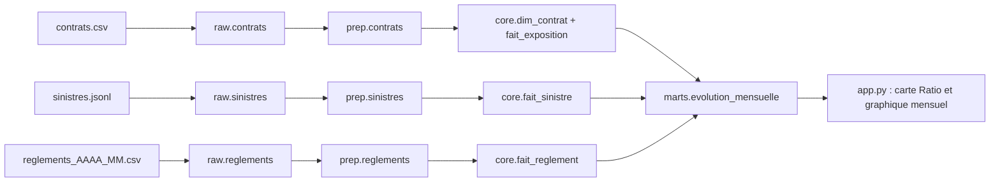

# Catalogue des données

Explication de chaque table et chaque colonne de l'entrepôt `warehouse/boreal.duckdb`. Généré par `python pipeline/catalogue.py`.

## Schéma `meta`

Méta : journal des chargements et résultats des tests.

### `meta.ingestion_log`

Journal d'ingestion : fichier, empreinte, lignes lues, durée, statut de chaque chargement. (102 lignes)

| Colonne | Type | Définition |
|---|---|---|
| `fichier` | VARCHAR | Fichier chargé. |
| `source` | VARCHAR | Table brute alimentée par le fichier. |
| `empreinte` | VARCHAR | Empreinte SHA-256 du contenu du fichier (détecte un fichier déjà chargé). |
| `lignes_lues` | BIGINT | Nombre de lignes lues dans le fichier. |
| `lignes_rejetees` | BIGINT | Nombre de lignes rejetées à la lecture. |
| `duree_s` | DOUBLE | Durée du chargement, en secondes. |
| `statut` | VARCHAR | Statut du sinistre (OUVERT, CLOTURE, REJETE, SANS_SUITE) ; pour les tables de suivi, statut du chargement ou du test. |
| `message` | VARCHAR | Message d'erreur éventuel. |
| `charge_le` | TIMESTAMP | Date et heure du chargement. |

### `meta.resultats_tests`

Résultats des tests de qualité à chaque exécution (couches brute et cœur). (19 lignes)

| Colonne | Type | Définition |
|---|---|---|
| `suite` | VARCHAR | Groupe de tests : couche brute ou couche cœur. |
| `test` | VARCHAR | Nom du test exécuté. |
| `description` | VARCHAR | Description de la règle. |
| `statut` | VARCHAR | Statut du sinistre (OUVERT, CLOTURE, REJETE, SANS_SUITE) ; pour les tables de suivi, statut du chargement ou du test. |
| `detail` | VARCHAR | Détail de l'anomalie ou de la ligne. |
| `execute_le` | TIMESTAMP | Date et heure d'exécution du test. |

## Schéma `raw`

Brut (raw) : copie fidèle des sources, tout en texte, sans aucune transformation.

### `raw.audits`

Audits antifraude (dossiers contrôlés uniquement). (372 lignes)

| Colonne | Type | Définition |
|---|---|---|
| `sinistre_id` | VARCHAR | Identifiant du sinistre. |
| `date_audit` | VARCHAR | Date de l'audit antifraude. |
| `fraude_confirmee` | VARCHAR | Vrai si l'audit a confirmé une fraude. |
| `_source_file` | VARCHAR | Fichier d'origine de la ligne (traçabilité). |
| `_loaded_at` | TIMESTAMP WITH TIME ZONE | Horodatage du chargement de la ligne. |

### `raw.clients`

Clients, tels que livrés par le CRM. (15 200 lignes)

| Colonne | Type | Définition |
|---|---|---|
| `client_id` | VARCHAR | Identifiant du client. |
| `date_naissance` | VARCHAR | Date de naissance du client. |
| `region` | VARCHAR | Région du client. |
| `csp` | VARCHAR | Catégorie socioprofessionnelle du client. |
| `consent_marketing` | VARCHAR | Consentement du client à la prospection commerciale. |
| `email_hash` | VARCHAR | Empreinte (hash) de l'e-mail : pseudonyme servant à repérer les doublons. |
| `_source_file` | VARCHAR | Fichier d'origine de la ligne (traçabilité). |
| `_loaded_at` | TIMESTAMP WITH TIME ZONE | Horodatage du chargement de la ligne. |

### `raw.contrats`

Contrats auto et habitation, tels que livrés. (20 264 lignes)

| Colonne | Type | Définition |
|---|---|---|
| `contrat_id` | VARCHAR | Identifiant du contrat. |
| `client_id` | VARCHAR | Identifiant du client. |
| `produit` | VARCHAR | Produit : AUTO ou HABITATION. |
| `date_effet` | VARCHAR | Date de début de couverture du contrat. |
| `date_resiliation` | VARCHAR | Date de résiliation du contrat (vide si en vigueur). |
| `formule` | VARCHAR | Formule du contrat (ESSENTIELLE, CONFORT, PREMIUM). |
| `canal_distribution` | VARCHAR | Canal de vente (AGENT, COURTIER, WEB). |
| `zone_risque` | VARCHAR | Zone de risque, de 1 à 5. |
| `franchise` | VARCHAR | Franchise du contrat, en euros. |
| `bonus_malus` | VARCHAR | Coefficient de bonus-malus (auto). |
| `puissance_cv` | VARCHAR | Puissance fiscale du véhicule, en chevaux (auto). |
| `surface_m2` | VARCHAR | Surface du logement, en m² (habitation). |
| `prime_annuelle` | VARCHAR | Prime annuelle du contrat, en euros. |
| `_source_file` | VARCHAR | Fichier d'origine de la ligne (traçabilité). |
| `_loaded_at` | TIMESTAMP WITH TIME ZONE | Horodatage du chargement de la ligne. |

### `raw.reglements`

Paiements de sinistres, un fichier mensuel par livraison. (3 207 lignes)

| Colonne | Type | Définition |
|---|---|---|
| `paiement_id` | VARCHAR | Identifiant du paiement. |
| `sinistre_id` | VARCHAR | Identifiant du sinistre. |
| `date_paiement` | VARCHAR | Date du paiement. |
| `montant` | VARCHAR | Montant du paiement, en euros. |
| `montant_eur` | VARCHAR | Montant du paiement dans les fichiers qui utilisent cet autre intitulé de colonne. |
| `_source_file` | VARCHAR | Fichier d'origine de la ligne (traçabilité). |
| `_loaded_at` | TIMESTAMP | Horodatage du chargement de la ligne. |

### `raw.sinistres`

Sinistres déclarés, tels que livrés. (2 805 lignes)

| Colonne | Type | Définition |
|---|---|---|
| `sinistre_id` | VARCHAR | Identifiant du sinistre. |
| `contrat_id` | VARCHAR | Identifiant du contrat. |
| `date_survenance` | VARCHAR | Date à laquelle le sinistre est survenu. |
| `date_declaration` | VARCHAR | Date de déclaration du sinistre. |
| `garantie` | VARCHAR | Garantie mobilisée par le sinistre. |
| `statut` | VARCHAR | Statut du sinistre (OUVERT, CLOTURE, REJETE, SANS_SUITE) ; pour les tables de suivi, statut du chargement ou du test. |
| `reserve_initiale` | VARCHAR | Provision constituée à l'ouverture du dossier, en euros. |
| `_source_file` | VARCHAR | Fichier d'origine de la ligne (traçabilité). |
| `_loaded_at` | TIMESTAMP WITH TIME ZONE | Horodatage du chargement de la ligne. |

## Schéma `prep`

Préparation (prep) : types corrigés et valeurs nettoyées ; aucune ligne supprimée.

### `prep.audits`

Audits antifraude typés. (372 lignes)

| Colonne | Type | Définition |
|---|---|---|
| `sinistre_id` | INTEGER | Identifiant du sinistre. |
| `date_audit` | DATE | Date de l'audit antifraude. |
| `fraude_confirmee` | BOOLEAN | Vrai si l'audit a confirmé une fraude. |
| `_source_file` | VARCHAR | Fichier d'origine de la ligne (traçabilité). |
| `_loaded_at` | TIMESTAMP WITH TIME ZONE | Horodatage du chargement de la ligne. |

### `prep.clients`

Clients typés et nettoyés. (15 200 lignes)

| Colonne | Type | Définition |
|---|---|---|
| `client_id` | INTEGER | Identifiant du client. |
| `date_naissance` | DATE | Date de naissance du client. |
| `region` | VARCHAR | Région du client. |
| `csp` | VARCHAR | Catégorie socioprofessionnelle du client. |
| `consent_marketing` | BOOLEAN | Consentement du client à la prospection commerciale. |
| `email_hash` | VARCHAR | Empreinte (hash) de l'e-mail : pseudonyme servant à repérer les doublons. |
| `_source_file` | VARCHAR | Fichier d'origine de la ligne (traçabilité). |
| `_loaded_at` | TIMESTAMP WITH TIME ZONE | Horodatage du chargement de la ligne. |

### `prep.contrats`

Contrats typés et nettoyés. (20 264 lignes)

| Colonne | Type | Définition |
|---|---|---|
| `contrat_id` | INTEGER | Identifiant du contrat. |
| `client_id` | INTEGER | Identifiant du client. |
| `produit` | VARCHAR | Produit : AUTO ou HABITATION. |
| `date_effet` | DATE | Date de début de couverture du contrat. |
| `date_resiliation` | DATE | Date de résiliation du contrat (vide si en vigueur). |
| `formule` | VARCHAR | Formule du contrat (ESSENTIELLE, CONFORT, PREMIUM). |
| `canal_distribution` | VARCHAR | Canal de vente (AGENT, COURTIER, WEB). |
| `zone_risque` | INTEGER | Zone de risque, de 1 à 5. |
| `franchise` | DOUBLE | Franchise du contrat, en euros. |
| `bonus_malus` | DOUBLE | Coefficient de bonus-malus (auto). |
| `puissance_cv` | DOUBLE | Puissance fiscale du véhicule, en chevaux (auto). |
| `surface_m2` | DOUBLE | Surface du logement, en m² (habitation). |
| `prime_annuelle` | DOUBLE | Prime annuelle du contrat, en euros. |
| `_source_file` | VARCHAR | Fichier d'origine de la ligne (traçabilité). |
| `_loaded_at` | TIMESTAMP WITH TIME ZONE | Horodatage du chargement de la ligne. |

### `prep.reglements`

Règlements typés ; les deux intitulés de montant sont unifiés. (3 207 lignes)

| Colonne | Type | Définition |
|---|---|---|
| `paiement_id` | INTEGER | Identifiant du paiement. |
| `sinistre_id` | INTEGER | Identifiant du sinistre. |
| `date_paiement` | DATE | Date du paiement. |
| `montant` | DOUBLE | Montant du paiement, en euros. |
| `_source_file` | VARCHAR | Fichier d'origine de la ligne (traçabilité). |
| `_loaded_at` | TIMESTAMP | Horodatage du chargement de la ligne. |

### `prep.sinistres`

Sinistres typés et nettoyés. (2 805 lignes)

| Colonne | Type | Définition |
|---|---|---|
| `sinistre_id` | INTEGER | Identifiant du sinistre. |
| `contrat_id` | INTEGER | Identifiant du contrat. |
| `date_survenance` | DATE | Date à laquelle le sinistre est survenu. |
| `date_declaration` | DATE | Date de déclaration du sinistre. |
| `garantie` | VARCHAR | Garantie mobilisée par le sinistre. |
| `statut` | VARCHAR | Statut du sinistre (OUVERT, CLOTURE, REJETE, SANS_SUITE) ; pour les tables de suivi, statut du chargement ou du test. |
| `reserve_initiale` | DOUBLE | Provision constituée à l'ouverture du dossier, en euros. |
| `_source_file` | VARCHAR | Fichier d'origine de la ligne (traçabilité). |
| `_loaded_at` | TIMESTAMP WITH TIME ZONE | Horodatage du chargement de la ligne. |

## Schéma `qualite`

Qualité : anomalies détectées, lignes mises en quarantaine et registre des règles.

### `qualite.anomalies`

Une ligne par anomalie détectée par une règle de qualité. (583 lignes)

| Colonne | Type | Définition |
|---|---|---|
| `regle_id` | VARCHAR | Identifiant de la règle de qualité (Q01...). |
| `table_source` | VARCHAR | Table contrôlée. |
| `cle` | VARCHAR | Identifiant de la ligne concernée. |
| `detail` | VARCHAR | Détail de l'anomalie ou de la ligne. |
| `motif` | VARCHAR | Motif du rejet ou de l'anomalie. |
| `traitement` | VARCHAR | Traitement appliqué (Signaler, Corriger, Exclure). |
| `detecte_le` | TIMESTAMP | Horodatage de la détection. |

### `qualite.quarantaine`

Lignes écartées des calculs, avec leur motif. (283 lignes)

| Colonne | Type | Définition |
|---|---|---|
| `regle_id` | VARCHAR | Identifiant de la règle de qualité (Q01...). |
| `table_source` | VARCHAR | Table contrôlée. |
| `cle` | VARCHAR | Identifiant de la ligne concernée. |
| `detail` | VARCHAR | Détail de l'anomalie ou de la ligne. |
| `motif` | VARCHAR | Motif du rejet ou de l'anomalie. |
| `traitement` | VARCHAR | Traitement appliqué (Signaler, Corriger, Exclure). |
| `detecte_le` | TIMESTAMP | Horodatage de la détection. |

### `qualite.registre`

Définition et volume constaté de chaque règle de qualité. (23 lignes)

| Colonne | Type | Définition |
|---|---|---|
| `regle_id` | VARCHAR | Identifiant de la règle de qualité (Q01...). |
| `categorie` | VARCHAR | Catégorie de la règle (complétude, unicité...). |
| `description` | VARCHAR | Description de la règle. |
| `table_source` | VARCHAR | Table contrôlée. |
| `gravite` | VARCHAR | Gravité (Mineure, Majeure, Bloquante). |
| `traitement` | VARCHAR | Traitement appliqué (Signaler, Corriger, Exclure). |
| `requete` | VARCHAR | Requête SQL de la règle. |
| `volume` | BIGINT | Nombre de lignes concernées. |

## Schéma `core`

Cœur (core) : modèle en étoile, dédoublonné, prêt pour le calcul des indicateurs.

### `core.dim_client`

Dimension client (clients survivants après déduplication). (15 000 lignes)

| Colonne | Type | Définition |
|---|---|---|
| `client_id` | INTEGER | Identifiant du client. |
| `date_naissance` | DATE | Date de naissance du client. |
| `age` | BIGINT | Âge du client à la date d'arrêté. |
| `tranche_age` | VARCHAR | Tranche d'âge du client. |
| `region` | VARCHAR | Région du client. |
| `csp` | VARCHAR | Catégorie socioprofessionnelle du client. |
| `consent_marketing` | BOOLEAN | Consentement du client à la prospection commerciale. |

### `core.dim_contrat`

Dimension contrat, avec marquage des contrats en quarantaine. (20 264 lignes)

| Colonne | Type | Définition |
|---|---|---|
| `contrat_id` | INTEGER | Identifiant du contrat. |
| `client_id` | INTEGER | Identifiant du client. |
| `segment_id` | BIGINT | Identifiant du segment de risque. |
| `produit` | VARCHAR | Produit : AUTO ou HABITATION. |
| `formule` | VARCHAR | Formule du contrat (ESSENTIELLE, CONFORT, PREMIUM). |
| `canal_distribution` | VARCHAR | Canal de vente (AGENT, COURTIER, WEB). |
| `date_effet` | DATE | Date de début de couverture du contrat. |
| `date_resiliation` | DATE | Date de résiliation du contrat (vide si en vigueur). |
| `franchise` | DOUBLE | Franchise du contrat, en euros. |
| `prime_annuelle` | DOUBLE | Prime annuelle du contrat, en euros. |
| `en_quarantaine` | BOOLEAN | Vrai si le contrat est écarté des calculs. |
| `motif_quarantaine` | VARCHAR | Motif de la mise en quarantaine. |

### `core.dim_date`

Dimension calendrier, un jour par ligne. (2 008 lignes)

| Colonne | Type | Définition |
|---|---|---|
| `date_jour` | DATE | Jour du calendrier. |
| `annee` | BIGINT | Année. |
| `trimestre` | BIGINT | Trimestre (1 à 4). |
| `mois` | BIGINT | Numéro du mois (1 à 12). |
| `annee_mois` | VARCHAR | Année et mois (AAAA-MM). |
| `jour_semaine` | BIGINT | Jour de la semaine (1 = lundi). |

### `core.dim_garantie`

Dimension garantie (par produit). (8 lignes)

| Colonne | Type | Définition |
|---|---|---|
| `garantie_id` | BIGINT | Identifiant de la garantie. |
| `produit` | VARCHAR | Produit : AUTO ou HABITATION. |
| `garantie` | VARCHAR | Garantie mobilisée par le sinistre. |

### `core.dim_segment_risque`

Dimension segment de risque (produit, classe de risque, zone). (30 lignes)

| Colonne | Type | Définition |
|---|---|---|
| `segment_id` | BIGINT | Identifiant du segment de risque. |
| `produit` | VARCHAR | Produit : AUTO ou HABITATION. |
| `classe_risque` | VARCHAR | Classe de risque du segment. |
| `zone_risque` | INTEGER | Zone de risque, de 1 à 5. |

### `core.fait_exposition`

Fait : couverture de chaque contrat, année par année (années-police et prime acquise). (65 103 lignes)

| Colonne | Type | Définition |
|---|---|---|
| `contrat_id` | INTEGER | Identifiant du contrat. |
| `annee` | BIGINT | Année. |
| `date_debut` | DATE | Début de la période de couverture dans l'année. |
| `date_fin` | DATE | Fin de la période de couverture dans l'année. |
| `jours_couverture` | BIGINT | Nombre de jours couverts dans l'année. |
| `annees_police` | DOUBLE | Années-police : jours couverts ÷ jours de l'année (mesure d'exposition). |
| `prime_acquise` | DOUBLE | Prime acquise : prime annuelle × années-police, en euros. |

### `core.fait_reglement`

Fait : un paiement par ligne. (3 175 lignes)

| Colonne | Type | Définition |
|---|---|---|
| `paiement_id` | INTEGER | Identifiant du paiement. |
| `sinistre_id` | INTEGER | Identifiant du sinistre. |
| `date_paiement` | DATE | Date du paiement. |
| `montant` | DOUBLE | Montant du paiement, en euros. |
| `_source_file` | VARCHAR | Fichier d'origine de la ligne (traçabilité). |

### `core.fait_sinistre`

Fait : un sinistre par ligne, avec règlements cumulés et fraude confirmée. (2 805 lignes)

| Colonne | Type | Définition |
|---|---|---|
| `sinistre_id` | INTEGER | Identifiant du sinistre. |
| `contrat_id` | INTEGER | Identifiant du contrat. |
| `garantie_id` | BIGINT | Identifiant de la garantie. |
| `date_survenance` | DATE | Date à laquelle le sinistre est survenu. |
| `date_declaration` | DATE | Date de déclaration du sinistre. |
| `statut` | VARCHAR | Statut du sinistre (OUVERT, CLOTURE, REJETE, SANS_SUITE) ; pour les tables de suivi, statut du chargement ou du test. |
| `reserve_initiale` | DOUBLE | Provision constituée à l'ouverture du dossier, en euros. |
| `montant_regle` | DOUBLE | Total réglé sur le sinistre, en euros. |
| `nb_reglements` | BIGINT | Nombre de paiements du sinistre. |
| `fraude_confirmee` | BOOLEAN | Vrai si l'audit a confirmé une fraude. |
| `contrat_en_quarantaine` | BOOLEAN | Vrai si le contrat du sinistre est en quarantaine. |

### `core.pont_client_survivant`

Pont entre chaque client et le client survivant de son groupe de doublons. (15 200 lignes)

| Colonne | Type | Définition |
|---|---|---|
| `client_id` | INTEGER | Identifiant du client. |
| `client_id_survivant` | INTEGER | Client conservé pour le groupe de doublons. |
| `email_hash` | VARCHAR | Empreinte (hash) de l'e-mail : pseudonyme servant à repérer les doublons. |
| `est_doublon` | BOOLEAN | Vrai si le client est un doublon écarté. |

## Schéma `marts`

Marts : tables d'analyse alimentant le dashboard (une table par besoin de lecture).

### `marts.base_technique`

Base technique annuelle par produit, zone, formule, canal et tranche d'âge. (2 544 lignes)

| Colonne | Type | Définition |
|---|---|---|
| `annee` | BIGINT | Année. |
| `produit` | VARCHAR | Produit : AUTO ou HABITATION. |
| `zone_risque` | INTEGER | Zone de risque, de 1 à 5. |
| `formule` | VARCHAR | Formule du contrat (ESSENTIELLE, CONFORT, PREMIUM). |
| `canal` | VARCHAR | Canal de vente (AGENT, COURTIER, WEB). |
| `tranche_age` | VARCHAR | Tranche d'âge du client. |
| `nb_contrats` | BIGINT | Nombre de contrats. |
| `annees_police` | DOUBLE | Années-police : jours couverts ÷ jours de l'année (mesure d'exposition). |
| `prime_acquise` | DOUBLE | Prime acquise : prime annuelle × années-police, en euros. |
| `nb_resiliations` | HUGEINT | Nombre de résiliations. |
| `nb_sinistres` | HUGEINT | Nombre de sinistres retenus (OUVERT ou CLOTURE). |
| `nb_sans_suite` | HUGEINT | Nombre de sinistres sans suite (exclus). |
| `nb_rejetes` | HUGEINT | Nombre de sinistres rejetés (exclus). |
| `paye` | DOUBLE | Montant payé, en euros. |
| `reserve_restante` | DOUBLE | Provision restante sur les dossiers, en euros. |

### `marts.contributions_segments`

Contribution de chaque segment au ratio, par année. (108 lignes)

| Colonne | Type | Définition |
|---|---|---|
| `annee` | BIGINT | Année. |
| `axe` | VARCHAR | Axe d'analyse (zone, formule, canal, tranche d'âge, produit). |
| `modalite` | VARCHAR | Valeur de l'axe d'analyse. |
| `part_ratio` | DOUBLE | Part du segment dans l'exposition ou les primes. |
| `contribution` | DOUBLE | Contribution du segment au ratio. |

### `marts.delais_sinistres`

Délais de gestion de chaque sinistre. (2 800 lignes)

| Colonne | Type | Définition |
|---|---|---|
| `sinistre_id` | INTEGER | Identifiant du sinistre. |
| `produit` | VARCHAR | Produit : AUTO ou HABITATION. |
| `garantie` | VARCHAR | Garantie mobilisée par le sinistre. |
| `statut` | VARCHAR | Statut du sinistre (OUVERT, CLOTURE, REJETE, SANS_SUITE) ; pour les tables de suivi, statut du chargement ou du test. |
| `delai_declaration` | BIGINT | Jours entre la survenance et la déclaration. |
| `delai_premier_reglement` | BIGINT | Jours entre la déclaration et le premier règlement. |
| `delai_cloture` | BIGINT | Jours entre la déclaration et le dernier règlement (dossiers clôturés). |

### `marts.evolution_annuelle`

Évolution annuelle du ratio et décomposition de sa variation. (6 lignes)

| Colonne | Type | Définition |
|---|---|---|
| `annee` | BIGINT | Année. |
| `annee_incomplete` | BOOLEAN | Vrai si l'année n'est pas complète (données arrêtées en cours d'année). |
| `annees_police` | DOUBLE | Années-police : jours couverts ÷ jours de l'année (mesure d'exposition). |
| `nb_sinistres` | HUGEINT | Nombre de sinistres retenus (OUVERT ou CLOTURE). |
| `paye` | DOUBLE | Montant payé, en euros. |
| `prime_acquise` | DOUBLE | Prime acquise : prime annuelle × années-police, en euros. |
| `frequence` | DOUBLE | Fréquence : sinistres ÷ années-police. |
| `cout_moyen` | DOUBLE | Coût moyen : montant payé ÷ sinistres. |
| `prime_moyenne` | DOUBLE | Prime moyenne : primes acquises ÷ années-police, en euros. |
| `ratio` | DOUBLE | Ratio sinistres/primes : montant payé ÷ primes acquises. |
| `ratio_avec_reserve` | DOUBLE | Ratio incluant la provision restante. |
| `ratio_hors_exceptionnel` | DOUBLE | Ratio sans le sinistre exceptionnel (> 1 M€). |
| `part_dossiers_ouverts` | DOUBLE | Part des dossiers encore ouverts. |
| `variation_ratio` | DOUBLE | Variation du ratio par rapport à l'année précédente (en points). |
| `effet_frequence` | DOUBLE | Part de la variation du ratio due à la fréquence. |
| `effet_cout` | DOUBLE | Part de la variation du ratio due au coût moyen. |
| `effet_prime` | DOUBLE | Part de la variation du ratio due à la prime moyenne. |
| `variation_sinistres` | DOUBLE | Variation du montant des sinistres sur un an. |
| `sinistres_effet_volume` | DOUBLE | Part due au volume d'exposition. |
| `sinistres_effet_frequence` | DOUBLE | Part due à la fréquence. |
| `sinistres_effet_cout` | DOUBLE | Part due au coût moyen. |
| `variation_primes` | DOUBLE | Variation du montant des primes sur un an. |
| `primes_effet_volume` | DOUBLE | Part due au volume d'exposition. |
| `primes_effet_prime` | DOUBLE | Part due à la prime moyenne. |

### `marts.evolution_mensuelle`

Série mensuelle par produit, zone et canal : source des graphiques de la page Portefeuille. (1 980 lignes)

| Colonne | Type | Définition |
|---|---|---|
| `mois` | DATE | Premier jour du mois. |
| `annee` | BIGINT | Année. |
| `mois_num` | BIGINT | Numéro du mois (1 à 12). |
| `produit` | VARCHAR | Produit : AUTO ou HABITATION. |
| `zone_risque` | INTEGER | Zone de risque, de 1 à 5. |
| `canal` | VARCHAR | Canal de vente (AGENT, COURTIER, WEB). |
| `contrats_actifs` | BIGINT | Contrats en vigueur le mois considéré. |
| `annees_police` | DOUBLE | Années-police : jours couverts ÷ jours de l'année (mesure d'exposition). |
| `prime_acquise` | DOUBLE | Prime acquise : prime annuelle × années-police, en euros. |
| `nb_resiliations` | HUGEINT | Nombre de résiliations. |
| `nb_sinistres` | BIGINT | Nombre de sinistres retenus (OUVERT ou CLOTURE). |
| `paye` | DOUBLE | Montant payé, en euros. |
| `nb_exceptionnels` | BIGINT | Nombre de sinistres exceptionnels (> 1 M€). |
| `paye_exceptionnel` | DOUBLE | Montant payé sur les sinistres exceptionnels. |
| `reserve_restante` | DOUBLE | Provision restante sur les dossiers, en euros. |

### `marts.exploitation`

État de la chaîne : chargements, règles de qualité et tests. (47 lignes)

| Colonne | Type | Définition |
|---|---|---|
| `rubrique` | VARCHAR | Rubrique : CHARGEMENT, REGLE ou TEST. |
| `element` | VARCHAR | Source, règle ou test concerné. |
| `detail` | VARCHAR | Détail de l'anomalie ou de la ligne. |
| `valeur` | DOUBLE | Lignes chargées, lignes signalées ou rejetées, ou nombre de tests selon la rubrique. |
| `valeur2` | DOUBLE | Valeur complémentaire de la ligne (selon la rubrique). |
| `statut` | VARCHAR | Statut du chargement, gravité ou traitement de la règle, résultat du test. |
| `horodatage` | TIMESTAMP | Date et heure de l'exécution. |
| `derniere_date_donnee` | DATE | Date la plus récente présente dans les données. |

### `marts.indicateurs`

Indicateurs (fréquence, coût moyen, ratio...) par axe d'analyse. (19 lignes)

| Colonne | Type | Définition |
|---|---|---|
| `axe` | VARCHAR | Axe d'analyse (zone, formule, canal, tranche d'âge, produit). |
| `modalite` | VARCHAR | Valeur de l'axe d'analyse. |
| `annees_police` | DOUBLE | Années-police : jours couverts ÷ jours de l'année (mesure d'exposition). |
| `nb_sinistres` | HUGEINT | Nombre de sinistres retenus (OUVERT ou CLOTURE). |
| `frequence` | DOUBLE | Fréquence : sinistres ÷ années-police. |
| `cout_moyen` | DOUBLE | Coût moyen : montant payé ÷ sinistres. |
| `prime_moyenne` | DOUBLE | Prime moyenne : primes acquises ÷ années-police, en euros. |
| `ratio_paye` | DOUBLE | Ratio sinistres/primes : montant payé ÷ primes acquises. |
| `ratio_avec_reserve` | DOUBLE | Ratio incluant la provision restante. |
| `taux_resiliation` | DOUBLE | Taux de résiliation : résiliations ÷ années-police. |
| `reserve_restante` | DOUBLE | Provision restante sur les dossiers, en euros. |
| `nb_sans_suite` | HUGEINT | Nombre de sinistres sans suite (exclus). |
| `nb_rejetes` | HUGEINT | Nombre de sinistres rejetés (exclus). |

### `marts.retention_cohortes`

Rétention des contrats par cohorte de souscription. (30 lignes)

| Colonne | Type | Définition |
|---|---|---|
| `cohorte` | BIGINT | Année de souscription de la cohorte. |
| `produit` | VARCHAR | Produit : AUTO ou HABITATION. |
| `k` | BIGINT | Nombre d'années écoulées depuis la souscription. |
| `contrats` | BIGINT | Contrats de la cohorte. |
| `retenus` | BIGINT | Contrats encore en vigueur au 31/12. |
| `retention_pct` | DOUBLE | Part des contrats conservés. |

### `marts.retention_multidetention`

Rétention selon le niveau de détention (mono ou multi-produits). (60 lignes)

| Colonne | Type | Définition |
|---|---|---|
| `niveau` | VARCHAR | Niveau de détention (mono ou multi-produits). |
| `statut` | VARCHAR | Statut du sinistre (OUVERT, CLOTURE, REJETE, SANS_SUITE) ; pour les tables de suivi, statut du chargement ou du test. |
| `cohorte` | BIGINT | Année de souscription de la cohorte. |
| `k` | BIGINT | Nombre d'années écoulées depuis la souscription. |
| `effectif` | BIGINT | Nombre de contrats ou clients observés. |
| `retenus` | BIGINT | Contrats encore en vigueur au 31/12. |
| `retention_pct` | DOUBLE | Part des contrats conservés. |

### `marts.valeur_client`

Valeur de chaque client : primes acquises moins sinistres payés. (14 972 lignes)

| Colonne | Type | Définition |
|---|---|---|
| `client_id` | INTEGER | Identifiant du client. |
| `tranche_age` | VARCHAR | Tranche d'âge du client. |
| `region` | VARCHAR | Région du client. |
| `csp` | VARCHAR | Catégorie socioprofessionnelle du client. |
| `nb_contrats` | BIGINT | Nombre de contrats. |
| `nb_produits` | BIGINT | Nombre de produits détenus par le client. |
| `annees_police` | DOUBLE | Années-police : jours couverts ÷ jours de l'année (mesure d'exposition). |
| `primes_acquises` | DOUBLE | Primes acquises du client, en euros. |
| `nb_sinistres` | BIGINT | Nombre de sinistres retenus (OUVERT ou CLOTURE). |
| `paye` | DOUBLE | Montant payé, en euros. |
| `valeur` | DOUBLE | Valeur : primes acquises − sinistres payés, en euros. |

## Lignage du ratio sinistres/primes

